<picture></picture>

<picture></picture>

 <picture></picture>
<picture></picture>

 <picture></picture>
<picture></picture>

 <picture></picture>
<picture></picture>

 <picture></picture>
<picture></picture>

<picture></picture>

