<picture></picture>

<a href="#user-content-screen"><samp><picture></picture></samp></a>

<a href="#user-content-screen"><picture></picture></a>

 

 

 

 

 <a href="#user-content-run-_stats"><samp><picture></picture></samp></a><a href="#user-content-run-_streak"><samp><picture></picture></samp></a><a href="#user-content-run-_lines"><picture></picture></a><a href="#user-content-run-_activity"><samp><picture></picture></samp></a><a href="#user-content-run-_help"><picture></picture></a><a href="#user-content-run-_clear"><samp><picture></picture></samp></a><a href="#user-content-screen"><samp><picture></picture></samp></a>

<a href="#user-content-screen"><picture><source media="(prefers-color-scheme: light)" srcset="https://github.com/jae0y2n/jae0y2n/raw/main/r-_stats-light.svg"></picture></a>

<a href="#user-content-screen"><picture></picture></a>

<a href="#user-content-screen"><picture><source media="(prefers-color-scheme: light)" srcset="https://github.com/jae0y2n/jae0y2n/raw/main/r-_lines-light.svg"></picture></a>

<a href="#user-content-screen"><picture></picture></a>

<a href="#user-content-screen"><picture></picture></a>

<a href="#user-content-run-_stats"><samp><picture></picture></samp></a><a href="#user-content-run-_streak"><samp><picture></picture></samp></a><a href="#user-content-run-_lines"><picture></picture></a><a href="#user-content-run-_activity"><samp><picture></picture></samp></a><a href="#user-content-run-_help"><picture></picture></a><a href="#user-content-run-_clear"><samp><picture></picture></samp></a><a href="#user-content-screen"><samp><picture></picture></samp></a><picture></picture>
 

