<code>/stats</code>

<picture>
  <source media="(prefers-color-scheme: dark)" srcset="https://github.com/jae0y2n/jae0y2n/raw/main/stats-dark.svg">
  
</picture>

<code>/streak</code>

<picture>
  <source media="(prefers-color-scheme: dark)" srcset="https://github.com/jae0y2n/jae0y2n/raw/main/streak-dark.svg">
  
</picture>

<code>/lines</code>

<picture>
  <source media="(prefers-color-scheme: dark)" srcset="https://github.com/jae0y2n/jae0y2n/raw/main/lines-dark.svg">
  
</picture>

<code>/activity</code>

<picture>
  <source media="(prefers-color-scheme: dark)" srcset="https://github.com/jae0y2n/jae0y2n/raw/main/activity-dark.svg">
  
</picture>

<code>/help</code>

<picture>
  <source media="(prefers-color-scheme: dark)" srcset="https://github.com/jae0y2n/jae0y2n/raw/main/help-dark.svg">
  
</picture>

